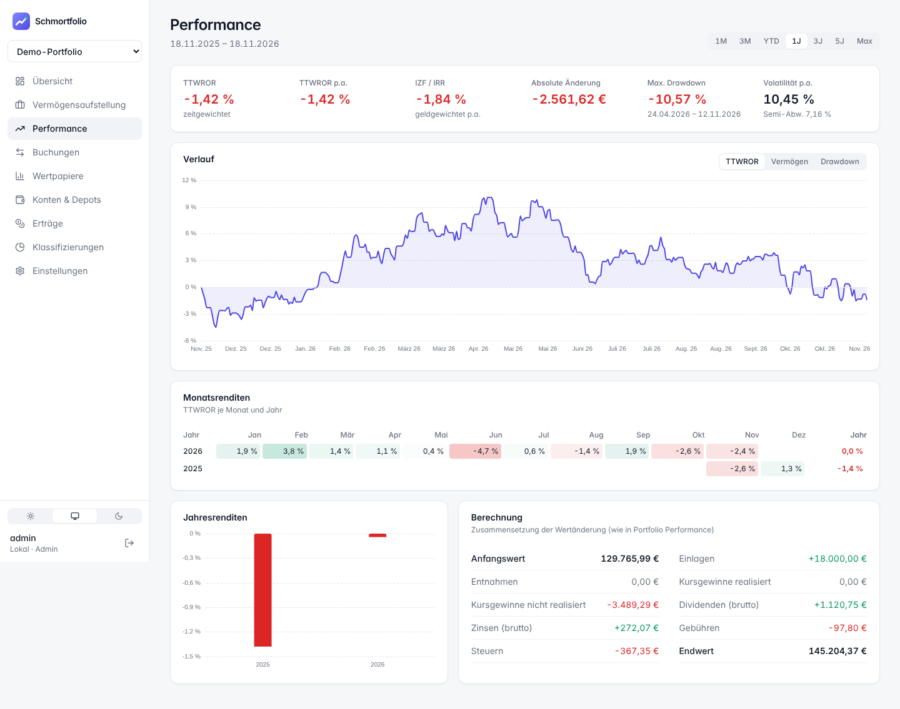
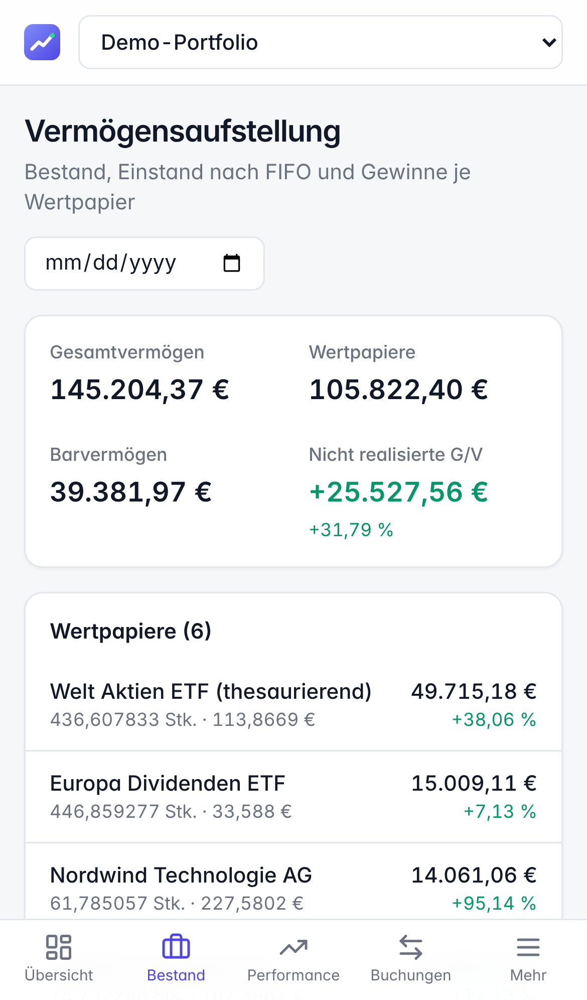

# SchmortfolioPerformance

Selbsthostbare Neuimplementierung von [Portfolio Performance](https://www.portfolio-performance.info/) als Web-App mit PWA. Das Backend ist in Rust geschrieben, das Frontend in React. Ausgeliefert wird ein einzelner Docker-Container. PP-Dateien lassen sich verlustfrei importieren.


| Performance | Dunkles Design | Mobil |
|---|---|---|
|  |  |  |

## Funktionen (Version 1.0)

- **Umstieg von Portfolio Performance:** Import von XML-, Binär-, verschlüsselten und ZIP-Dateien aller
  Versionen, inklusive Klassifizierungen, Watchlists und Sparplänen. Export zurück als PP-XML.
- **Gleiche Zahlen wie PP:** TTWROR, IZF, FIFO-Einstand, Drawdown und Volatilität; Golden Tests gegen PPs
  eigene Testsuite.
- **Auswertungen:** Übersicht, Vermögensaufstellung mit Stichtag, Performance mit Monatsrenditen, Erträge,
  Klassifizierungen mit Rebalancing; Filter auf einzelne Depots und Konten.
- **Erfassung:** alle Buchungsarten inklusive Fremdwährung, Umbuchungen und Depotwechsel; Bearbeiten per Klick;
  Sparpläne mit automatischer Ausführung.
- **Kurse:** Yahoo Finance, JSON, HTML-Tabelle, CoinGecko, Alpha Vantage, manuell oder per Einfügen aus Excel;
  EZB-Wechselkurse.
- **Import:** PDF-Belege über YAML-Regeln (Trade Republic, Scalable Capital, ING, DKB, eigene Regeln), CSV mit
  Spaltenzuordnung, Duplikaterkennung, Original-PDF als Beleg.
- **Betrieb:** lokale Anmeldung oder OIDC/SSO, mehrere Benutzer, API-Tokens (z. B. für Home Assistant), tägliche
  Backups, PWA mit Offline-Lesezugriff, mobile Ansicht, dunkles Design. Ein Docker-Container mit SQLite.

Dokumentation:

- [Benutzerhandbuch](docs/user-guide.md)
- [Eigene PDF-Regeln](docs/pdf-rules.md)
- [Änderungen](CHANGELOG.md)
- [Umsetzungsplan](docs/PLAN.md)
- API-Dokumentation unter `/api/docs`

## Schnellstart mit Docker

```bash
docker compose up -d --build
# http://localhost:8080 öffnen: beim ersten Aufruf wird der Administrator angelegt
```

Die Daten liegen in `./data` (SQLite).

## Konfiguration (Umgebungsvariablen)

| Variable | Standard | Beschreibung |
|---|---|---|
| `PP_PUBLIC_URL` | `http://localhost:8080` | Öffentliche URL (Cookies, OIDC-Redirect) |
| `PP_BIND` | `0.0.0.0:8080` | Adresse, auf der der Server lauscht |
| `PP_DATA_DIR` | `./data` (`/data` im Container) | Datenverzeichnis |
| `PP_DATABASE_URL` | `sqlite://$PP_DATA_DIR/schmortfolio.db` | Datenbank |
| `PP_ADMIN_USERNAME` / `PP_ADMIN_PASSWORD` | – | Legt beim ersten Start einen Admin an |
| `PP_DISABLE_LOCAL_LOGIN` | `false` | Nur SSO zulassen |
| `PP_SESSION_DAYS` | `30` | Gültigkeit der Sitzung in Tagen |
| `PP_ECB_UPDATE` | `true` | EZB-Kurse automatisch laden |
| `PP_QUOTE_UPDATE` | `true` | Wertpapierkurse alle 6 Stunden aktualisieren |
| `PP_BACKUP_KEEP` | `14` | Anzahl täglicher Backups (`0` = aus) |
| `PP_MAX_UPLOAD_MB` | `200` | Maximale Größe beim Import |
| `PP_LOG` / `PP_LOG_FORMAT` | `info` / Text | Log-Filter, `json` für strukturierte Logs |

### OIDC / SSO

| Variable | Standard | Beschreibung |
|---|---|---|
| `PP_OIDC_ISSUER` | – | Issuer-URL; aktiviert SSO |
| `PP_OIDC_CLIENT_ID` / `PP_OIDC_CLIENT_SECRET` | – | Client-Zugangsdaten |
| `PP_OIDC_REDIRECT_URL` | `$PP_PUBLIC_URL/api/v1/auth/oidc/callback` | Diese URL beim Provider eintragen |
| `PP_OIDC_SCOPES` | `openid profile email` | |
| `PP_OIDC_BUTTON_LABEL` | `Mit SSO anmelden` | |
| `PP_OIDC_AUTO_REGISTER` | `true` | Neue Benutzer automatisch anlegen |
| `PP_OIDC_LINK_BY_EMAIL` | `false` | Bestehendes lokales Konto über die verifizierte E-Mail verknüpfen |
| `PP_OIDC_GROUPS_CLAIM` | `groups` | Claim mit den Gruppen (auch verschachtelt, z. B. `realm_access.roles`) |
| `PP_OIDC_ALLOWED_GROUPS` | – | Nur Mitglieder dieser Gruppen dürfen sich anmelden |
| `PP_OIDC_ADMIN_GROUPS` | – | Mitglieder werden Administratoren |

## Entwicklung

```bash
# Backend (Port 8080)
cargo run -p pp-server
# Frontend mit Hot Reload (Port 5173, leitet /api an 8080 weiter)
cd web && pnpm install && pnpm dev
# Tests
cargo test --workspace
# TypeScript-Client nach API-Änderungen neu erzeugen
cd web && pnpm api
```

Aufbau des Repositorys:

```
crates/pp-core     Domänenmodell und Berechnungen (ohne IO)
crates/pp-import   Import/Export von PP-Dateien, PDF-Regelengine (rules/)
crates/pp-db       SQLite-Persistenz
crates/pp-quotes   Kursquellen und EZB-Wechselkurse
crates/pp-server   HTTP-API, Authentifizierung, Jobs, eingebettetes Frontend
web/               React-PWA
testdata/          Referenzdateien und Belegtexte aus der PP-Testsuite (EPL-1.0)
```

## Lizenz

Noch nicht festgelegt (siehe Plan, M0). Die Dateien unter `testdata/pp` und `crates/pp-import/proto/client.proto` stammen aus Portfolio Performance und stehen unter der EPL-1.0.
