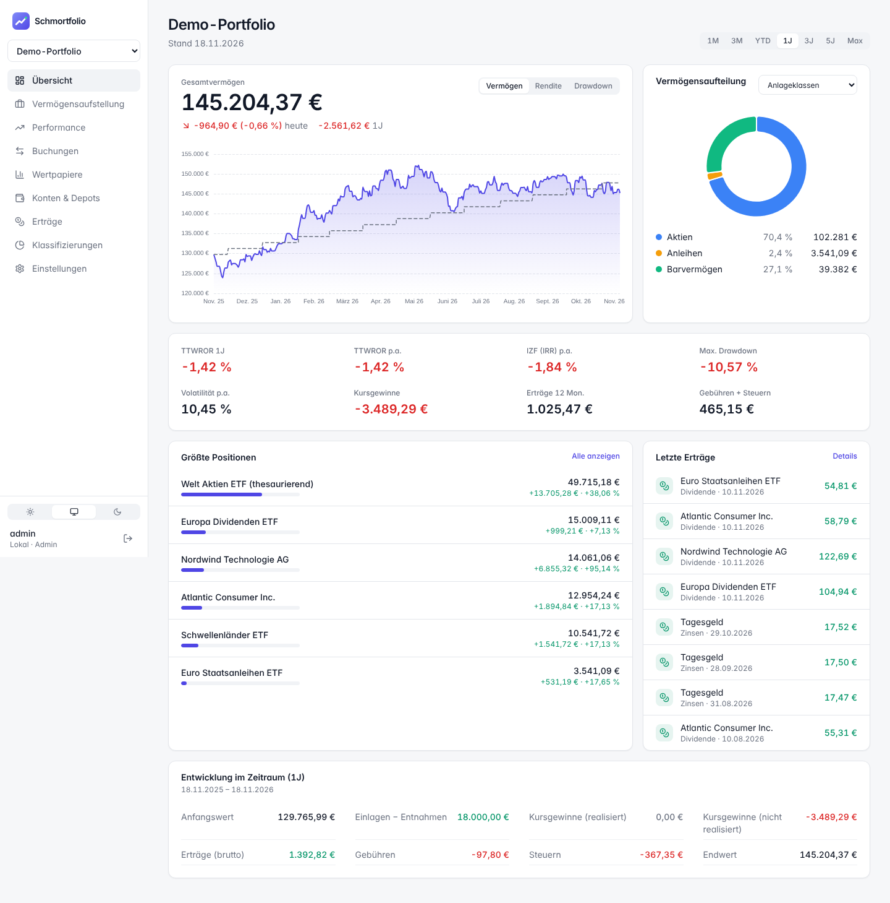
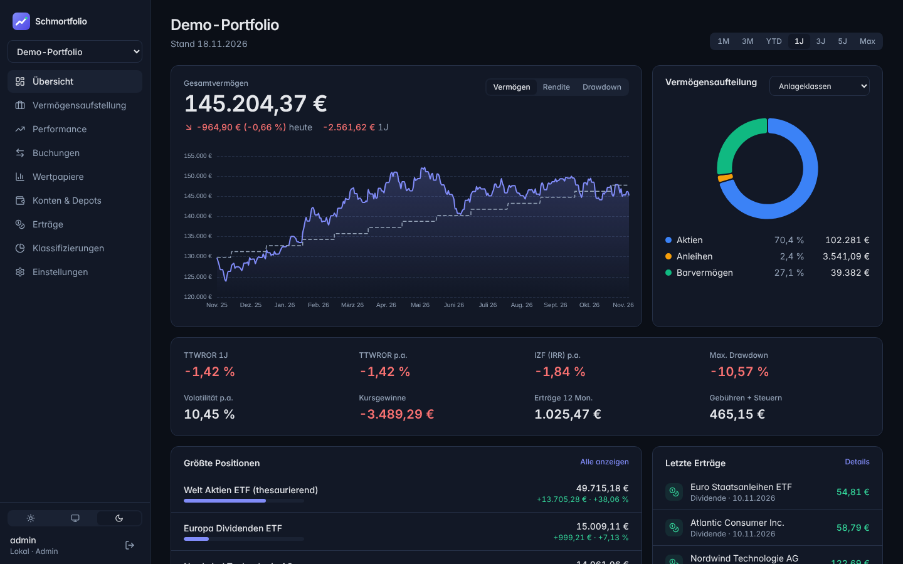

# SchmortfolioPerformance

Selbsthostbare Neuimplementierung von [Portfolio Performance](https://www.portfolio-performance.info/) als Web-App mit PWA. Das Backend ist in Rust geschrieben, das Frontend in React. Ausgeliefert wird ein einzelner Docker-Container. PP-Dateien lassen sich verlustfrei importieren.



| Performance | Dunkles Design | Mobil |
|---|---|---|
|  |  |  |

## Stand (Meilensteine M0–M4)

- **Import aus Portfolio Performance:** XML mit relativen und ID-Referenzen, Binärformat (Protobuf), verschlüsselte Dateien (AES-128/256) und ZIP. Alte Dateiversionen werden automatisch migriert, Skalierung von Stückzahlen und Kursen eingeschlossen.
- **Rechenkern mit PP-identischen Ergebnissen:** Vermögensaufstellung, FIFO- und Durchschnittseinstand, realisierte und nicht realisierte Gewinne, TTWROR, IZF (IRR), Drawdown und Volatilität. Geprüft wird mit Golden Tests gegen die Erwartungswerte aus PPs eigener Testsuite (cent-genau, IRR auf 10⁻⁸ genau).
- **Auswertungen:** Übersicht, Vermögensaufstellung (mit Stichtag), Performance mit Monats- und Jahresrenditen, Erträge, Klassifizierungen, Wertpapiere mit Kursverlauf, Konten und Depots, Buchungen.
- **Erfassung:** Einlagen, Entnahmen, Käufe, Verkäufe, Dividenden, Zinsen, Gebühren und Steuern. Käufe und Verkäufe werden als Buchungspaar angelegt; Fremdwährungsbuchungen sind noch nicht möglich.
- **Wechselkurse:** EZB-Referenzkurse werden automatisch geladen. Fehlt ein Kurs, wird er aus den Wechselkursen in den Buchungen abgeleitet.
- **Login:** lokale Konten oder OIDC/SSO (Authentik, Authelia, Keycloak, Pocket ID, …) mit PKCE, Gruppen-Freigabe, Admin-Gruppe und Abmeldung beim Provider.
- **Oberfläche:** PWA (installierbar, Offline-Lesecache), mobile Ansicht mit Tab-Leiste, helles und dunkles Design.
- **API:** REST-API mit OpenAPI-Dokumentation unter `/api/docs`; der TypeScript-Client wird daraus generiert.
- **Demo-Portfolio:** fünf Jahre generierte Beispieldaten zum Ausprobieren.

Was als Nächstes kommt, steht im Umsetzungsplan unter [docs/PLAN.md](docs/PLAN.md) (M5ff.: Kurs-Feeds, PDF-Import, Fremdwährungsbuchungen, …).

## Schnellstart mit Docker

```bash
docker compose up -d --build
# http://localhost:8080 öffnen: beim ersten Aufruf wird der Administrator angelegt
```

Die Daten liegen in `./data` (SQLite).

## Konfiguration (Umgebungsvariablen)

| Variable | Standard | Beschreibung |
|---|---|---|
| `PP_PUBLIC_URL` | `http://localhost:8080` | Öffentliche URL (Cookies, OIDC-Redirect) |
| `PP_BIND` | `0.0.0.0:8080` | Adresse, auf der der Server lauscht |
| `PP_DATA_DIR` | `./data` (`/data` im Container) | Datenverzeichnis |
| `PP_DATABASE_URL` | `sqlite://$PP_DATA_DIR/schmortfolio.db` | Datenbank |
| `PP_ADMIN_USERNAME` / `PP_ADMIN_PASSWORD` | – | Legt beim ersten Start einen Admin an |
| `PP_DISABLE_LOCAL_LOGIN` | `false` | Nur SSO zulassen |
| `PP_SESSION_DAYS` | `30` | Gültigkeit der Sitzung in Tagen |
| `PP_ECB_UPDATE` | `true` | EZB-Kurse automatisch laden |
| `PP_MAX_UPLOAD_MB` | `200` | Maximale Größe beim Import |
| `PP_LOG` / `PP_LOG_FORMAT` | `info` / Text | Log-Filter, `json` für strukturierte Logs |

### OIDC / SSO

| Variable | Standard | Beschreibung |
|---|---|---|
| `PP_OIDC_ISSUER` | – | Issuer-URL; aktiviert SSO |
| `PP_OIDC_CLIENT_ID` / `PP_OIDC_CLIENT_SECRET` | – | Client-Zugangsdaten |
| `PP_OIDC_REDIRECT_URL` | `$PP_PUBLIC_URL/api/v1/auth/oidc/callback` | Diese URL beim Provider eintragen |
| `PP_OIDC_SCOPES` | `openid profile email` | |
| `PP_OIDC_BUTTON_LABEL` | `Mit SSO anmelden` | |
| `PP_OIDC_AUTO_REGISTER` | `true` | Neue Benutzer automatisch anlegen |
| `PP_OIDC_LINK_BY_EMAIL` | `false` | Bestehendes lokales Konto über die verifizierte E-Mail verknüpfen |
| `PP_OIDC_GROUPS_CLAIM` | `groups` | Claim mit den Gruppen (auch verschachtelt, z. B. `realm_access.roles`) |
| `PP_OIDC_ALLOWED_GROUPS` | – | Nur Mitglieder dieser Gruppen dürfen sich anmelden |
| `PP_OIDC_ADMIN_GROUPS` | – | Mitglieder werden Administratoren |

## Entwicklung

```bash
# Backend (Port 8080)
cargo run -p pp-server
# Frontend mit Hot Reload (Port 5173, leitet /api an 8080 weiter)
cd web && pnpm install && pnpm dev
# Tests
cargo test --workspace
# TypeScript-Client nach API-Änderungen neu erzeugen
cd web && pnpm api
```

Aufbau des Repositorys:

```
crates/pp-core     Domänenmodell und Berechnungen (ohne IO)
crates/pp-import   Import von PP-Dateien
crates/pp-db       SQLite-Persistenz
crates/pp-quotes   Kurs- und Wechselkursquellen (EZB)
crates/pp-server   HTTP-API, Authentifizierung, Jobs, eingebettetes Frontend
web/               React-PWA
testdata/pp        Referenzdateien aus der PP-Testsuite (EPL-1.0)
```

## Lizenz

Noch nicht festgelegt (siehe Plan, M0). Die Dateien unter `testdata/pp` und `crates/pp-import/proto/client.proto` stammen aus Portfolio Performance und stehen unter der EPL-1.0.
